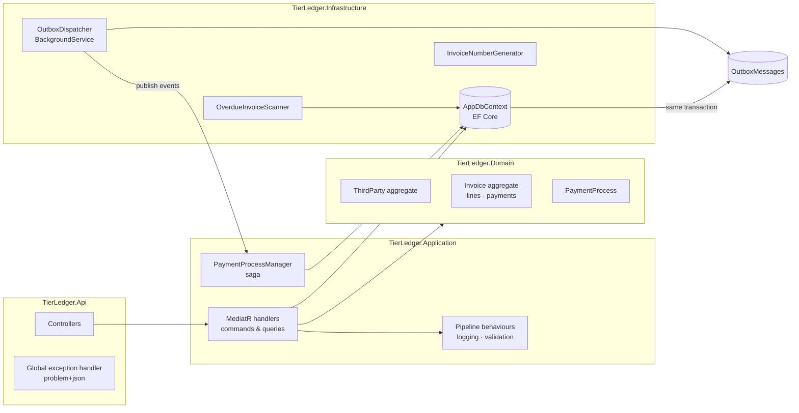
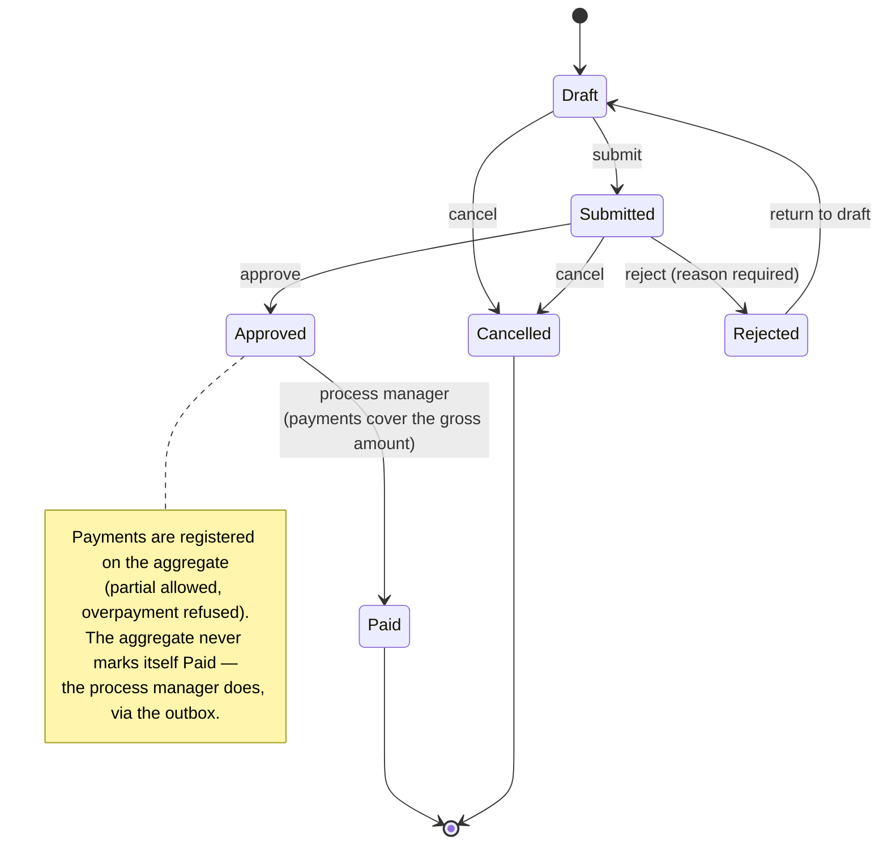

# TierLedger

A third-party (*tiers*) and supplier-invoice lifecycle service with an accounting flavour, built as a clean-architecture ASP.NET Core API.

TierLedger manages **third parties** (suppliers and customers) and their **invoices** through a guarded lifecycle — `Draft → Submitted → Approved → Paid` — where payments may arrive in parts and an event-driven **process manager** (saga) completes an invoice only once it is fully settled. Domain events are persisted through a **transactional outbox** in the same database transaction as the state change, then dispatched asynchronously, so the workflow survives restarts and never loses an event.

> Built from scratch as a reference implementation of the patterns I use in production .NET work: CQRS with MediatR, domain-driven aggregates, EF Core, the outbox pattern, and a process-manager saga.

## Architecture



**Dependency rule:** `Domain` knows nothing about EF Core, HTTP, or MediatR contracts beyond `INotification`. `Application` defines the ports (`IApplicationDbContext`, `IInvoiceNumberGenerator`); `Infrastructure` implements them; `Api` is a thin HTTP shell.

## The invoice lifecycle



How a payment completes an invoice, end to end:

1. `POST /api/invoices/{id}/payments` → `RecordPaymentCommand` → the aggregate records the payment and raises `PaymentRecorded`.
2. `AppDbContext.SaveChangesAsync` converts the event into an **outbox row in the same transaction**.
3. `OutboxDispatcher` (background service) picks the row up and publishes it through MediatR.
4. `PaymentProcessManager` accumulates the amount on the `PaymentProcess` started when the invoice was approved. When the total is covered, it loads the invoice and calls `MarkAsPaid()`, then completes the process.

Every step is idempotent: a redelivered `InvoiceApproved` never starts a second process, and a redelivered `PaymentRecorded` is recognised by its payment id.

A second background service, `OverdueInvoiceScanner`, periodically flags payment processes whose due date has passed and raises `InvoiceOverdue`.

## Run it

### Docker Compose (API + SQL Server)

```bash
docker compose up --build
```

- API + Swagger UI: <http://localhost:8080/swagger>
- Health: <http://localhost:8080/health>
- The API applies its EF Core migrations on startup (with retry while SQL Server warms up).
- The SA password in `docker-compose.yml` is a demo value — change it anywhere real.

### Local .NET (SQLite, zero setup)

Requires the .NET 10 SDK.

```bash
dotnet run --project src/TierLedger.Api
```

- API + Swagger UI: <http://localhost:5080/swagger>
- Defaults to a local SQLite file (`tierledger.db`, created automatically).
- In `Development`, the API seeds two third parties and a draft invoice so you can click through the lifecycle immediately.

### Tests

```bash
dotnet test
```

45 tests: domain rules, MediatR handlers against a real EF Core/SQLite context, the process manager, validators, and full HTTP lifecycle tests through `WebApplicationFactory` (including the outbox-driven transition to `Paid`).

## API surface

| Area | Endpoint | Notes |
| --- | --- | --- |
| Third parties | `POST /api/third-parties` | `TaxId` is unique |
| | `GET /api/third-parties` | paging + `type`, `isActive`, `search` filters |
| | `GET /api/third-parties/{id}` | |
| | `PUT /api/third-parties/{id}` | |
| | `POST /api/third-parties/{id}/deactivate` · `/reactivate` | deactivated parties can't take new invoices |
| | `GET /api/third-parties/{id}/outstanding-balance` | open amounts **grouped by currency** |
| Invoices | `POST /api/invoices` | number assigned server-side: `INV-{year}-{seq:D4}` |
| | `GET /api/invoices` | paging + `thirdPartyId`, `status`, `overdueOnly` filters |
| | `GET /api/invoices/{id}` | includes lines, payments, totals |
| | `PUT /api/invoices/{id}` | revise — drafts only |
| | `POST /api/invoices/{id}/submit` · `/approve` · `/reject` · `/return-to-draft` · `/cancel` | guarded transitions |
| | `POST /api/invoices/{id}/payments` | partial payments; overpayment → `409` |
| | `GET /api/invoices/{id}/payment-process` | saga state for the invoice |
| System | `GET /health` | includes a database check |

Errors are RFC 9110 problem details: validation failures → `400` with a grouped `errors` map, unknown ids → `404`, business-rule violations → `409`.

## Design decisions

- **CQRS with MediatR.** One handler per use case, vertical slices under `Application/Features`. Cross-cutting concerns are pipeline behaviours: `LoggingBehaviour` and `ValidationBehaviour` (FluentValidation runs before the handler, never inside it). *MediatR is pinned to 12.4.1 — the last Apache-2.0 release line.*
- **Aggregates guard the rules.** The `Invoice` aggregate recomputes totals from its lines (per-line tax rounded to 2 dp, `AwayFromZero`), refuses illegal transitions, and refuses overpayment. Controllers and handlers contain no business rules.
- **Transactional outbox over direct publishing.** Events raised during `SaveChanges` are serialised into `OutboxMessages` in the same transaction. The dispatcher is at-least-once; consumers are idempotent. No message broker is needed at this scale, and no event can be lost between commit and publish.
- **A process manager, not event choreography alone.** The `PaymentProcess` is a persisted saga state per invoice: it accumulates partial payments, completes the invoice at full settlement, aborts on cancellation, and tracks overdue state. Its state is queryable through the API, which choreography-only designs can't offer.
- **Money is `decimal` end to end**, stored as `decimal(18,2)`. Line tax is rounded per line, not per invoice, matching common invoicing practice.
- **Invoice numbering** uses a per-year counter row (`INV-2026-0001`), updated inside the caller's transaction; a unique index on `Invoices.Number` is the concurrency backstop.
- **Provider strategy.** EF Core with SQL Server in production (Docker Compose, migrations applied at startup) and SQLite for local runs and tests (`EnsureCreated`). The provider is a configuration switch: `Database:Provider = SqlServer | Sqlite`.
- **Domain-assigned keys.** All Guid keys are generated by the domain factories and configured `ValueGenerated.Never`. This is load-bearing: with the store-generated convention, EF Core's change detection mistakes a child added to a tracked aggregate's collection (a new `Payment`) for an existing row and issues an `UPDATE` instead of an `INSERT`. The model configuration documents this in `AppDbContext`.
- **Structured logging** with Serilog (console sink, request logging), configuration-driven levels.

## Deliberately out of scope

Authentication/authorization, PDF invoice generation, multi-currency conversion (balances are reported per currency, never converted), a frontend, and a real message broker — each is a separable concern that would obscure the patterns this project demonstrates.

## Layout

```
src/
  TierLedger.Domain/          aggregates, value objects, domain events
  TierLedger.Application/     CQRS slices, pipeline behaviours, process manager
  TierLedger.Infrastructure/  EF Core, outbox dispatcher, overdue scanner, migrations
  TierLedger.Api/             controllers, problem-details mapping, Serilog, Swagger
tests/
  TierLedger.UnitTests/         domain, handlers, process manager, validators
  TierLedger.IntegrationTests/  WebApplicationFactory HTTP lifecycle tests
```

## License

MIT
